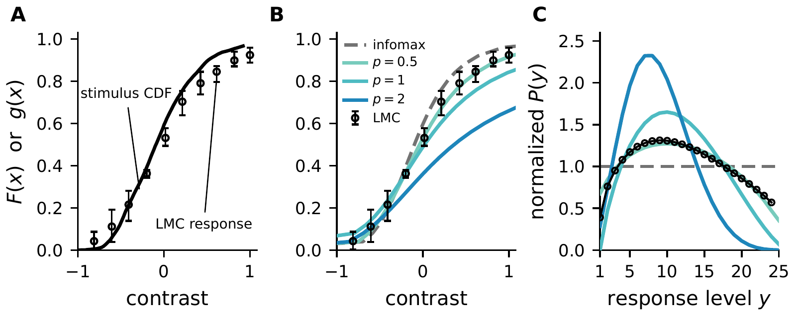

Unbelievable that it is out!
*Bayesian efficient coding*, with Jonathan Pillow, is now published in PLOS Computational Biology.
Jonathan and I started it when I was a postdoc in his lab at UT Austin; the oldest figure in our repository is from April 2012.
Since then, the paper has gone through six versions on bioRxiv and 516 commits.

| Years | Commits | Milestones |
|---|---:|---|
| 2012-2015 | 22 | first figures (April 2012), first commit (November 2012), COSYNE 2013 poster |
| 2016-2017 | 210 | bioRxiv v1 and v2 (August 2017) |
| 2018-2021 | 80 | bioRxiv v3 (July 2020), MATLAB replication code on Zenodo (August 2020) |
| 2022-2025 | 13 | bioRxiv v4 (March 2024) |
| 2026 | 191 | bioRxiv v5 (April) and v6 (September), Python replication code (October), published (November 4) |

## The idea

Efficient coding asks why neurons encode signals the way they do, given limited spikes, dynamic range, and energy.
The Bayesian brain hypothesis asks how the brain combines that sensory evidence with prior knowledge to infer the state of the world.
We ask both questions at once.
An optimal code is specified by a prior over stimuli, an encoding model, a constraint on neural resources, and a loss functional that scores the posterior distribution, what an observer can infer about the stimulus from the neural response.
With posterior entropy as the loss, the optimal code maximizes mutual information and we recover classical efficient coding; other losses give very different codes.
Using *covtropy*, a family of losses we introduce, we show that decorrelating sensory inputs, optimal for classical efficient codes at low noise, can be a disadvantage when large errors are costly.

**Covtropy.**
Let $$\sigma_i^2$$ be the eigenvalues of the posterior covariance $$\Sigma$$.
Covtropy of exponent $$p$$ is defined whenever $$\Sigma$$ exists, while the posterior entropy that infomax minimizes is bounded by the Gaussian case:

$$\begin{aligned}
L_{\text{covtropy}} &= \mathrm{Tr}\left[\Sigma^{\frac{p}{2}}\right] = \sum_i \sigma_i^{p}, \\
L_{\text{entropy}} &= H(\mathbf{x} \mid \mathbf{y}) \le \tfrac{1}{2} \log |2\pi e \Sigma| = \sum_i \log \sigma_i + \text{const}.
\end{aligned}$$

For Gaussian posteriors the bound holds with equality, and as $$p \to 0$$ minimizing covtropy is maximizing mutual information, since $$\lim_{p \to 0} \frac{1}{p}(\sigma^p - 1) = \log \sigma$$.
At $$p = 2$$ covtropy is the sum of posterior variances, the mean squared error, and as $$p \to \infty$$ minimizing it minimizes $$\max_i \sigma_i$$, a mini-max code.

And the contrast response Laughlin measured in the blowfly in 1981, the textbook example of information maximization, is better explained by minimizing the $$L_p$$ reconstruction error with $$p = 1/2$$.

## If you read an earlier version

Take another look at Figs 5 and 6.

**Fig 5 now has a closed form.**
For the log-logistic (Naka-Rushton) prior we fit to Laughlin's contrast distribution, the $$L_p$$-optimal nonlinearity, in the limit of many response levels, is a beta CDF warp of the prior CDF $$F$$:

$$g_p^\star(x) = I_{F(x)}\left(A_p, B_p\right), \qquad A_p = \frac{1 + p/b}{1+p}, \qquad B_p = \frac{1 - p/b}{1+p},$$

where $$I$$ is the regularized incomplete beta function and $$b$$ the Naka-Rushton exponent.
At $$p = 0$$ the warp is the identity, so Laughlin's histogram equalization is simply the $$p \to 0$$ member of the family.

*Fig 5. (A) Laughlin's measured LMC response (circles) and the CDF of the contrast distribution, which coincide under infomax. (B) Optimal nonlinearities for $$p = 1/2, 1, 2$$ and infomax (dashed). (C) Response distributions these codes induce, normalized so that infomax is flat, with the one implied by the measured response (circles).*

**Fig 6: H1 favors an even larger exponent.**
We redid the H1 analysis and added a heavy-tailed stimulus prior.
The best-matching loss exponent is now $$p = 5.75$$ with a Gaussian prior and $$p = 8.5$$ with a Student-t prior, up from $$p = 4$$.

Park, I. M. and Pillow, J. W. (2026). Bayesian efficient coding. *PLOS Computational Biology* 22(11): e1014894. [DOI](https://doi.org/10.1371/journal.pcbi.1014894), [bioRxiv](https://www.biorxiv.org/content/10.1101/178418), [code](https://doi.org/10.5281/zenodo.3970841)

The Python code on Zenodo reproduces Figs 3-6 and Figs A-D of S1 Appendix.

Written primarily by AI agents under Memming's direction.
Agents: Claude Opus 5.5 (claude-opus-5-5) via Claude Code 2.1.318 - drafted. 2026-11-06
{: .ai-attribution}
